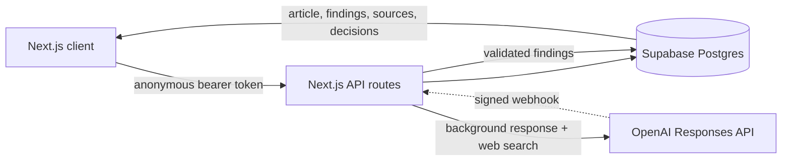

# PulseCheck — Product Requirements

**Status:** Deployed hackathon MVP

**Product:** Evidence-backed fact proofreading

**Live app:** [pulsecheck-omega.vercel.app](https://pulsecheck-omega.vercel.app)

## Product

PulseCheck answers one question: **What in this article still holds up today?**

A user pastes an article. PulseCheck researches its claims, preserves the original text, and places findings directly beside the relevant words. Supported corrections can be accepted in place or rejected. Every conclusion remains tied to evidence.

The product is designed for writers, editors, analysts, researchers, and readers reviewing time-sensitive material.

## Shipped experience

### Start a check

- Paste up to 20,000 characters.
- Optionally load the prepared demo article.
- Start the check without creating an account or seeing a login screen.
- Keep the article visible while research runs.

The prepared demo is deterministic. Other text uses an OpenAI background response with web search when the deployed environment is configured for live analysis.

### Review findings

PulseCheck renders the exact stored article and adds a neutral marker beside each investigated passage.

| Marker | Verdict | Meaning |
|---|---|---|
| `✓` | Verified | Current evidence supports the claim. |
| `↻` | Outdated | The claim was supportable but is no longer current. |
| `×` | Contradicted | Reliable evidence directly conflicts with the claim. |
| `?` | Unsupported or unresolved | Evidence is missing, insufficient, or conflicting. |
| `+` | Needs context | The wording overstates what the evidence supports. |
| `≈` | Opinion | The passage is subjective and is left unchanged. |

Selecting a marker opens an evidence panel with:

- verdict and confidence;
- a one-sentence explanation;
- proposed correction, when allowed;
- source links, publishers, and available publication dates;
- the date checked;
- accept and reject controls for editable findings.

Accepted corrections render as a struck-through original followed by a green replacement. Rejecting the finding restores the immutable original text.

### Reopen a check

Completed checks appear in **Recents**. The run ID is stored in the URL, so a result survives refresh and can be opened by another visitor. Edit decisions are stored separately for each anonymous session.

## Finding rules

Three fields remain separate:

| Field | Values |
|---|---|
| Claim type | `fact`, `forecast`, `opinion` |
| Verdict | `verified`, `outdated`, `contradicted`, `unsupported`, `needs_context`, `unresolved`, `opinion` |
| Forecast status | `pending`, `on_track`, `revised`, `fulfilled`, `missed`, `not_measurable`, or `null` |

Confidence is `high`, `medium`, or `low`. It describes confidence in one finding, not the percentage of an article that is true.

A replacement is allowed only when all of these are true:

1. The verdict is `outdated`, `contradicted`, or `needs_context`.
2. Confidence is high.
3. At least one supporting citation passed validation.
4. The quoted passage resolves to one unambiguous span in the original article.

Every `needs_context` finding includes a concise replacement that reads naturally in the surrounding paragraph. If the evidence cannot support that inline revision with high confidence, the server keeps it as an `unresolved` flag instead. Unsupported claims, unresolved claims, opinions, verified claims, and lower-confidence findings never receive an invented correction.

## Research and validation

For live checks, the server:

1. Stores the original article and server-generated check date.
2. Sends the article as untrusted data to the OpenAI Responses API.
3. Uses web search and asks for structured findings.
4. Prefers current primary or authoritative sources.
5. Cross-checks every cited URL against the response's search and citation metadata.
6. Enforces verdict, confidence, forecast, citation, and replacement rules with Zod.
7. Locates each quoted passage in the immutable article using deterministic UTF-16 offsets.
8. Drops invalid, uncited, ambiguous, or overlapping findings instead of rendering unsafe edits.
9. Persists valid findings and sources in one database transaction.

OpenAI starts work in the background. The result can complete through the signed webhook handler when configured or through idempotent polling reconciliation from the run endpoint.

## Data model

| Table | Stored data |
|---|---|
| `documents` | Original text, title, creator, timestamps |
| `analysis_runs` | Status, check date, provider response, model, errors |
| `findings` | Exact span, verdict, confidence, explanation, replacement |
| `sources` | Ordered evidence for a finding |
| `edit_decisions` | Accept, reject, or restored state per visitor and finding |
| `webhook_events` | Idempotency records for OpenAI webhook events |

Database functions create runs, complete findings atomically, and save decisions. The original article is protected by an immutability trigger. Generated TypeScript types mirror the SQL schema.

## Access and privacy

- Supabase creates an invisible anonymous session in the browser.
- Completed checks and their article text, findings, and sources are readable by other authenticated anonymous visitors.
- Edit decisions are private to the visitor who made them.
- Writes use narrow database functions; the browser never receives the Supabase secret key or OpenAI key.
- The UI warns users that checks are public and not to paste sensitive information.
- `.env*`, except the blank `.env.example`, and provider deployment metadata are ignored by Git.

This public gallery is a deliberate hackathon choice, not a private-document product model.

## Demo fixture

The prepared article in [`fixtures/demo-article.txt`](fixtures/demo-article.txt) contains nine findings that exercise the full review model:

- one verified claim;
- one outdated role;
- a revised forecast;
- two contradicted claims;
- one unsupported claim;
- one claim needing context;
- one unresolved forecast;
- one opinion.

Expected output lives in [`fixtures/demo-expected.json`](fixtures/demo-expected.json). In every environment, an exact demo match uses this fixture instead of spending OpenAI credit. The completed demo run is reused to avoid duplicate gallery entries.

## Architecture

- `app/` contains pages and API routes.
- `components/` contains the composer, article review, evidence panel, and product shell.
- `lib/contracts/` contains provider-neutral Zod schemas and TypeScript types.
- `lib/analysis/` contains the prompt, provider contract, fixture, and validation policy.
- `lib/domain/` contains pure span resolution and article rendering logic.
- `lib/server/` and `lib/supabase/` contain server adapters, lifecycle handling, and persistence.
- `supabase/` contains migrations and pgTAP security tests.

## Quality bar

The repository checks formatting, linting, TypeScript, contracts, domain behavior, component behavior, deterministic fixture output, browser flows, database security, and the production build. CI runs deterministic tests without hosted secrets or paid model calls. Live OpenAI evaluation is opt-in.

## Current limits

- Text paste and the prepared demo are the supported inputs. URL ingestion and file upload are not implemented.
- There is no named-account login, private workspace, export, or document deletion UI.
- The app does not calculate an overall article truth score.
- The app has no application-level usage quota or moderation queue. Provider-side spending limits protect the hackathon deployment.
- The OpenAI webhook is inactive unless `OPENAI_WEBHOOK_SECRET` is configured; polling still completes runs.
- The ChatGPT-style shell is presentation context. Navigation outside PulseCheck is intentionally inactive.

These limits should remain visible in judge review rather than being presented as finished features.
